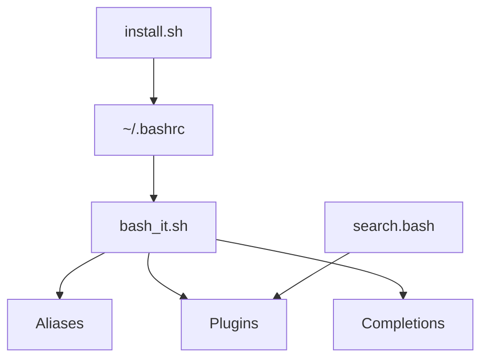

# Bash-it/bash-it

> Cadre pour Bash : alias, plugins, complétions et thèmes communautaires, à la manière d'oh-my-zsh.

## Le problème
Un `.bashrc` qui grossit sans structure, avec des scripts et alias dispersés.

## Ce que ça fait vraiment
Un chargeur (`bash_it.sh`) active à la demande des alias, plugins, complétions et thèmes. Une commande de recherche permet d'activer ou désactiver des composants, et `bash-it doctor` produit un diagnostic (version de Bash, composants actifs, état de la mise à jour). 97 % du code est compatible Bash 3.2+.

## Comment c'est branché


## Essayer
```bash
git clone --depth=1 https://github.com/Bash-it/bash-it.git ~/.bash_it
~/.bash_it/install.sh
bash-it doctor
```

## Coût et pièges
Gratuit. L'installateur modifie `~/.bashrc` (sauvegarde faite si le fichier existe). Quelques plugins demandent Bash 5.

## Ce que ce n'est pas
Pas un nouveau shell : il reste dans Bash. Ne marche pas pour zsh.

## Alternatives
oh-my-zsh, dont il est dit « démarqué ».

## Pour toi
À surveiller : utile si tu vis en Bash sous Linux ou WSL, mais le gain est cosmétique.

