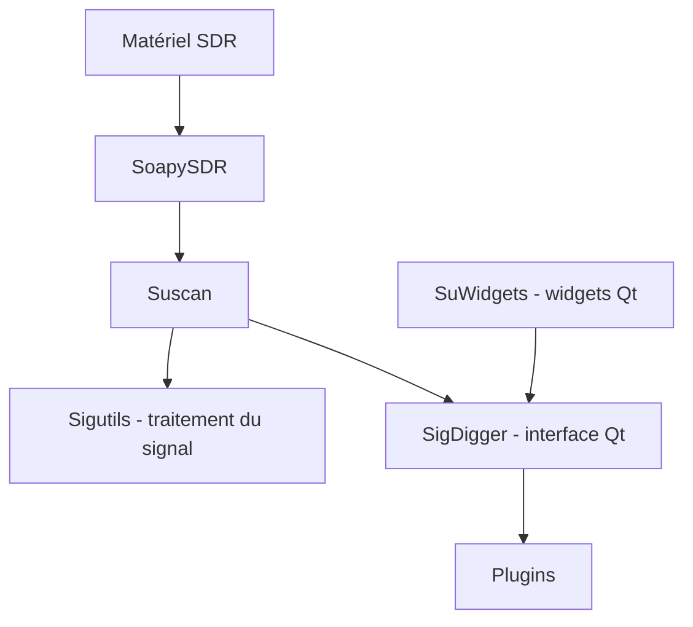

# BatchDrake/SigDigger

> Digital radio signal analyzer for GNU/Linux and macOS, with SDR devices through SoapySDR.

## The problem
Identifying and demodulating an unknown radio signal requires an interactive analysis tool, with spectrum, waterfall and real-time demodulation.

## What it actually does
Qt graphical interface wrapping the Suscan and Sigutils libraries. It accepts various SDR devices through SoapySDR, demodulates FSK, PSK and ASK, decodes analog video, analyzes burst signals and lets you listen to analog voice channels, in real time. The spectrum widget is derived from Gqrx's. Plugins (AmateurDSN, APTPlugin, AntSDRPlugin, ZeroMQPlugin) exist.

## How it is wired
Simplified diagram based on the sheet, no diagram provided.



## Trying it
```bash
git clone --recursive https://github.com/BatchDrake/sigutils
git clone --recursive https://github.com/BatchDrake/suscan
git clone https://github.com/BatchDrake/SuWidgets
git clone https://github.com/BatchDrake/SigDigger
cd SigDigger && qmake6 SigDigger.pro && make && sudo make install
```
Each dependency is built beforehand (see the README for the order); or `wget https://actinid.org/blsd`, `chmod a+x blsd`, `./blsd`.

## Cost and gotchas
Free. Four projects to compile before launching the tool. No reproducible Windows build, and the macOS `.dmg` must be requested from the author. An SDR receiver is needed for real use. Last push in February 2026.

## What it is not
It is not a turnkey radio receiver nor a machine learning tool: it is classic signal analysis. It does not reliably cover Windows.

## Alternatives
- Gqrx: the interface SigDigger takes inspiration from; it depends on GNU Radio, unlike SigDigger.

## For you
Ignore: a very specialized software-defined radio domain, with no direct link to data, AI or MLOps, and a heavy installation by a single maintainer.
