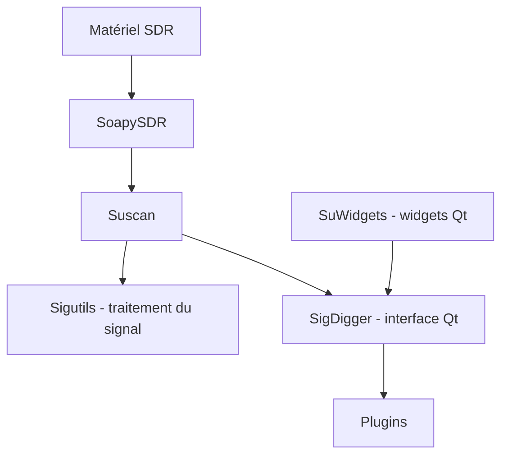

# BatchDrake/SigDigger

> Analyseur de signaux radio numériques pour GNU/Linux et macOS, avec périphériques SDR via SoapySDR.

## Le problème
Identifier et démoduler un signal radio inconnu demande un outil d'analyse interactif, avec spectre, cascade et démodulation en temps réel.

## Ce que ça fait vraiment
Interface graphique Qt qui enveloppe les bibliothèques Suscan et Sigutils. Elle accepte divers périphériques SDR via SoapySDR, démodule FSK, PSK et ASK, décode la vidéo analogique, analyse les signaux en rafales et fait écouter les canaux de voix analogique, en temps réel. Le widget de spectre est dérivé de celui de Gqrx. Des plugins (AmateurDSN, APTPlugin, AntSDRPlugin, ZeroMQPlugin) existent.

## Comment c'est branché
Schéma simplifié d'après la fiche, sans diagramme fourni.



## Essayer
```bash
git clone --recursive https://github.com/BatchDrake/sigutils
git clone --recursive https://github.com/BatchDrake/suscan
git clone https://github.com/BatchDrake/SuWidgets
git clone https://github.com/BatchDrake/SigDigger
cd SigDigger && qmake6 SigDigger.pro && make && sudo make install
```
Chaque dépendance se construit avant (voir le README pour l'ordre) ; ou `wget https://actinid.org/blsd`, `chmod a+x blsd`, `./blsd`.

## Coût et pièges
Gratuit. Compiler quatre projets avant de lancer l'outil. Pas de build Windows reproductible, et le `.dmg` macOS se demande à l'auteur. Un récepteur SDR est nécessaire pour un usage réel. Dernier push en février 2026.

## Ce que ce n'est pas
Ce n'est pas un récepteur radio clé en main ni un outil d'apprentissage automatique : c'est de l'analyse de signal classique. Il ne couvre pas Windows de façon fiable.

## Alternatives
- Gqrx : interface dont SigDigger s'inspire ; il dépend de GNU Radio, contrairement à SigDigger.

## Pour toi
À ignorer : domaine radio logicielle très spécialisé, sans lien direct avec data, IA ou MLOps, et installation lourde par un seul mainteneur.

