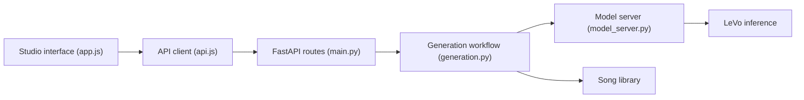

# BazedFrog/SongGeneration-Studio

> Local web interface to generate full songs with Tencent AI Lab's LeVo model.

## The problem
Using a music generation model directly requires managing its weights, queues and outputs by hand.

## What it actually does
A FastAPI and JavaScript interface takes structured lyrics, style (genre, mood, voice, tempo) and optional reference audio. A generation service sends tasks to a persistent LeVo model server. Separate tracks (mix, vocals, instrumental), the library, FLAC or MP4 export and the queue are provided.

## How it is wired

## Trying it
Installation via Pinokio, described in graphical steps: open Pinokio, search for "SongGeneration Studio", click Install. No shell command in the README.

## Cost and gotchas
NVIDIA GPU with 10 GB of VRAM minimum (24 GB recommended), 25 GB of disk, about 15 GB of models to download; 3 to 6 minutes per song. No license declared; the license of the LeVo model is not discussed. Last push in January 2026.

## What it is not
Not the model itself, but an interface around it. The quality tips ("audio references") are not measured.

## Alternatives
- LeVo (Tencent AI Lab): the underlying model, to use it without this layer.

## For you
Ignore: a simple interface with no declared license around a third-party model; without a clear license, no serious team usage.
