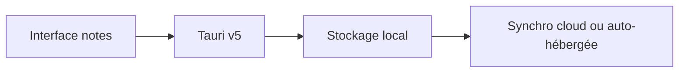

# Beaver-Notes/Beaver-Notes

> Local-first Markdown note-taking app, no account needed, on desktop and mobile.

## The problem
Many note-taking apps trade comfort for access to your data, with a mandatory account and a subscription.

## What it actually does
Markdown notes stored on the device, with folders, labels, links between notes and locked notes. Sync goes through your own cloud storage or a self-hosted server. The `tauri` branch (v5) rewrites the app from Electron to Tauri, with mobile, collaboration, history and plugins announced.

## How it is wired
Simplified diagram based on the sheet, no diagram provided.



## Trying it
```bash
git clone https://github.com/Beaver-Notes/Beaver-Notes.git
cd Beaver-Notes
git checkout tauri
yarn install
yarn tauri dev
```

## Cost and gotchas
Free, MIT. v5 is in beta with rough edges; the stable version is on the `development` branch. BeaverSync is announced for later.

## What it is not
Not a finished v5 yet: collaboration, plugins and history are README intentions, not achievements.

## Alternatives
No alternative named in the README.

## For you
Worth watching: a local, account-free alternative for your notes, but the ongoing v5 switch means waiting for it to stabilize.
