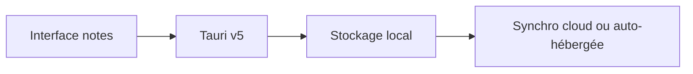

# Beaver-Notes/Beaver-Notes

> Application de notes Markdown locale d'abord, sans compte, sur ordinateur et mobile.

## Le problème
Beaucoup d'applications de notes échangent confort contre accès à tes données, avec compte obligatoire et abonnement.

## Ce que ça fait vraiment
Notes Markdown stockées sur l'appareil, avec dossiers, étiquettes, liens entre notes et notes verrouillées. La synchronisation se fait par ton stockage cloud ou un serveur auto-hébergé. La branche `tauri` (v5) réécrit l'app d'Electron vers Tauri, avec mobile, collaboration, historique et plugins annoncés.

## Comment c'est branché
Schéma simplifié d'après la fiche, sans diagramme fourni.



## Essayer
```bash
git clone https://github.com/Beaver-Notes/Beaver-Notes.git
cd Beaver-Notes
git checkout tauri
yarn install
yarn tauri dev
```

## Coût et pièges
Gratuit, MIT. La v5 est en bêta avec des aspérités ; la version stable est sur la branche `development`. BeaverSync est annoncé pour plus tard.

## Ce que ce n'est pas
Pas encore la v5 finie : collaboration, plugins et historique sont des intentions du README, pas des acquis.

## Alternatives
Aucune alternative nommée dans le README.

## Pour toi
À surveiller : alternative locale et sans compte pour tes notes, mais la bascule v5 en cours impose d'attendre la stabilisation.

