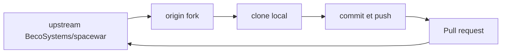

# BecoSystems/spacewar

> University exercise to learn fork and pull request, by writing a rule in a file.

## The problem
Students must practice the fork, clone, commit, push and pull request flow on a shared project.

## What it actually does
The README describes the roles of Programming 1 students (developers) and Programming 2 students (managers who accept or reject PRs). Each adds a rule to `spacewar-rules.md`. Rejection reasons are listed (rule already exists, PR without description, more than one line changed).

## How it is wired


## Trying it
```bash
git clone git@github.com:seuusuario/spacewar.git
cd spacewar
vim spacewar-rules.md
git push
```

## Cost and gotchas
Free. Text in Portuguese, intended for a specific course (Hydra environment); GPL-2.0.

## What it is not
Not a game nor a tool: a Git teaching exercise.

## Alternatives
No alternative named in the README.

## For you
Ignore: course exercise tied to a university context, no value for you.
