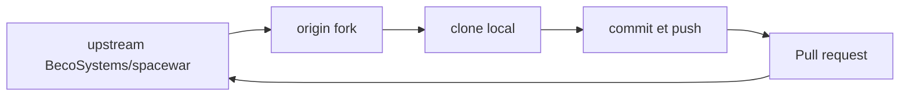

# BecoSystems/spacewar

> Exercice universitaire pour apprendre fork et pull request, en rédigeant une règle dans un fichier.

## Le problème
Des étudiants doivent pratiquer le flux fork, clone, commit, push et pull request sur un projet partagé.

## Ce que ça fait vraiment
Le README décrit le rôle des étudiants de Programmation 1 (développeurs) et de Programmation 2 (gestionnaires qui acceptent ou rejettent les PR). Chacun ajoute une règle dans `spacewar-rules.md`. Les motifs de rejet sont listés (règle déjà existante, PR sans description, plus d'une ligne modifiée).

## Comment c'est branché


## Essayer
```bash
git clone git@github.com:seuusuario/spacewar.git
cd spacewar
vim spacewar-rules.md
git push
```

## Coût et pièges
Gratuit. Texte en portugais, destiné à un cours précis (environnement Hydra) ; GPL-2.0.

## Ce que ce n'est pas
Pas un jeu ni un outil : un exercice de pédagogie Git.

## Alternatives
Aucune alternative nommée dans le README.

## Pour toi
À ignorer : exercice de cours lié à un contexte universitaire, sans valeur pour toi.

