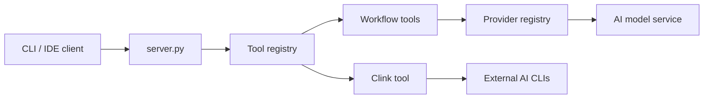

# BeehiveInnovations/pal-mcp-server

> MCP server that lets Claude Code, Codex or Gemini CLI consult several AI models and CLIs.

## The problem
A coding assistant uses only one model; getting a second opinion or delegating a big analysis means switching tools and losing context.

## What it actually does
MCP tools `chat`, `thinkdeep`, `planner`, `consensus`, `codereview`, `precommit`, `debug`, `apilookup`, `challenge` (others disabled by default).
Conversation thread shared across models and tools; works around the MCP 25K-token limit.
`clink` launches external CLIs (Gemini, Codex, Claude Code) as isolated sub-agents.
Providers: Gemini, OpenAI, Azure, X.AI, OpenRouter, DIAL, Ollama.

## How it is wired


## Trying it
```bash
git clone https://github.com/BeehiveInnovations/pal-mcp-server.git
cd pal-mcp-server
./run-server.sh
```

## Cost and gotchas
Each call to a second model is billed to your key; each active tool consumes context window.
License present but not identified by GitHub.

## What it is not
Not an autonomous agent: the main client stays in command.
Very promotional README: the claimed gains are not measured.

## Alternatives
No alternative named in the README.

## For you
Worth watching: the idea of multi-model consensus for code review is useful, but watch the bill and check the license before professional use.
