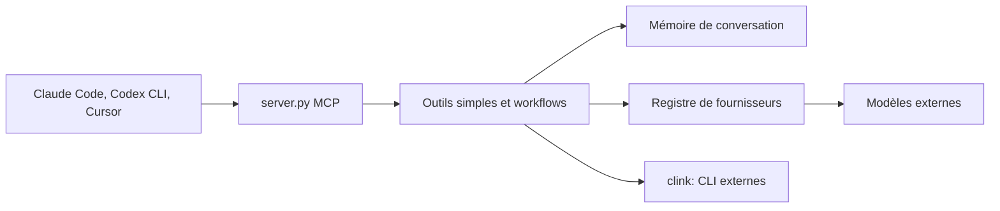

# BeehiveInnovations/zen-mcp-server

> PAL MCP (formerly Zen MCP): an MCP server that lets your coding CLI consult several models.

## The problem
A coding CLI has only one model and a limited context; getting a second opinion means copying the context over.

## What it actually does
An MCP server with tools: `chat`, `thinkdeep`, `planner`, `consensus`, `codereview`, `precommit`, `debug`, `apilookup`, `challenge`, and `clink`, which launches other CLIs (Gemini, Codex, Claude Code) as sub-agents. The conversation thread keeps context across tools and models. Providers: Gemini, OpenAI, Anthropic, Grok, Azure, Ollama, OpenRouter, DIAL.

## How it is wired


## Trying it
```bash
git clone https://github.com/BeehiveInnovations/pal-mcp-server.git
cd pal-mcp-server
./run-server.sh
```

## Cost and gotchas
API keys at your expense for each enabled provider; Python 3.10+, Git, uv. Each tool consumes context window: some are disabled by default via `DISABLED_TOOLS`.

## What it is not
Not an autonomous agent: your CLI stays in control. Multi-model multiplies costs, and the context sent goes to each consulted provider. The repo cited in the README has been renamed pal-mcp-server.

## Alternatives
No alternative named in the README.

## For you
Worth watching: multi-model second opinions are useful in code review, but the cost and sending code to several providers need to be measured.
