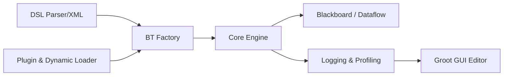

# BehaviorTree/BehaviorTree.CPP

> C++17 behavior-tree library for robotics and game AI.

## The problem
Replace rigid state machines with composable, reactive and asynchronous behaviors.

## What it actually does
Trees are described in XML loaded at runtime; control nodes, decorators, actions and conditions. First-class asynchronous actions, typed data flow through a Blackboard, custom nodes via static linking or plugins, and logging/profiling (ZeroMQ, SQLite) readable by Groot2.

## How it is wired


## Trying it
```bash
conan install . -s build_type=Release --build=missing
cmake --preset conan-release
cmake --build --preset conan-release
```

## Cost and gotchas
Free; C++17, CMake 3.23+ for Conan. ZeroMQ and SQLite dependencies. If the system `nlohmann::json` is used, everyone must link the same version.

## What it is not
Not a full ROS engine nor a learning tool: it is a tree execution engine.

## Alternatives
No alternative named in the README (Groot2 is the companion graphical editor).

## For you
Keep an eye on it: interesting if you orchestrate agents or robotics in C++; otherwise outside your day-to-day Python work.
