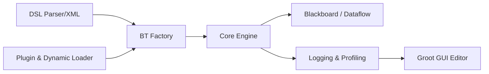

# BehaviorTree/BehaviorTree.CPP

> Bibliothèque C++17 d'arbres de comportement pour robotique et IA de jeux.

## Le problème
Remplacer des machines à états rigides par des comportements composables, réactifs et asynchrones.

## Ce que ça fait vraiment
Les arbres sont décrits en XML chargé à l'exécution ; nœuds de contrôle, décorateurs, actions et conditions. Actions asynchrones de premier rang, flux de données typé via Blackboard, nœuds personnalisés en lien statique ou plugins, journalisation/profilage (ZeroMQ, SQLite) lisible par Groot2.

## Comment c'est branché


## Essayer
```bash
conan install . -s build_type=Release --build=missing
cmake --preset conan-release
cmake --build --preset conan-release
```

## Coût et pièges
Gratuit ; C++17, CMake 3.23+ pour Conan. Dépendances ZeroMQ et SQLite. Si `nlohmann::json` système est utilisé, tout le monde doit linker la même version.

## Ce que ce n'est pas
Pas un moteur ROS complet ni un outil d'apprentissage : c'est un moteur d'exécution d'arbres.

## Alternatives
Aucune alternative nommée dans le README (Groot2 est l'éditeur graphique associé).

## Pour toi
À surveiller : intéressant si tu orchestres des agents ou de la robotique en C++ ; sinon hors de ton quotidien Python.

