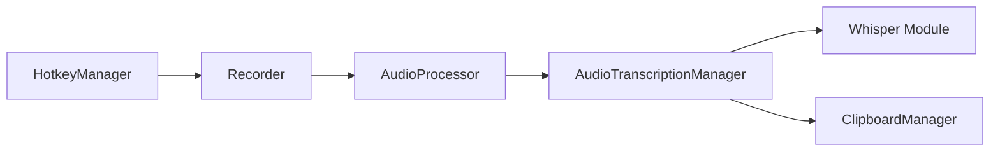

# Beingpax/VoiceInk

> Local macOS voice dictation app that transcribes speech to text via Whisper, for Mac users.

## The problem
Typing long texts is slow, and cloud dictation services send your voice to third parties.

## What it actually does
Transcribes offline with whisper.cpp, Parakeet (FluidAudio) and SenseVoice. Global shortcuts (push-to-talk), personal dictionary, "modes" depending on the active application, voice assistant and contextual AI enhancement. Requires macOS 14.4+. Source code is open; the official binary is paid with a free trial.

## How it is wired


## Trying it
```bash
brew install --cask voiceink
```
To build from source: follow BUILDING.md (not reproduced in the README).

## Cost and gotchas
Paid binary after the trial (updates and support included); building yourself is free but without automatic updates. The "AI" features may call external services, not detailed.

## What it is not
Not cross-platform (macOS only). The "100% offline" promise applies to local mode; the exact license remains to be verified.

## Alternatives
None named in the README (whisper.cpp is cited as a building block).

## For you
Worth watching: interesting if you are on Mac and want local dictation; clarify the license before any professional use.
