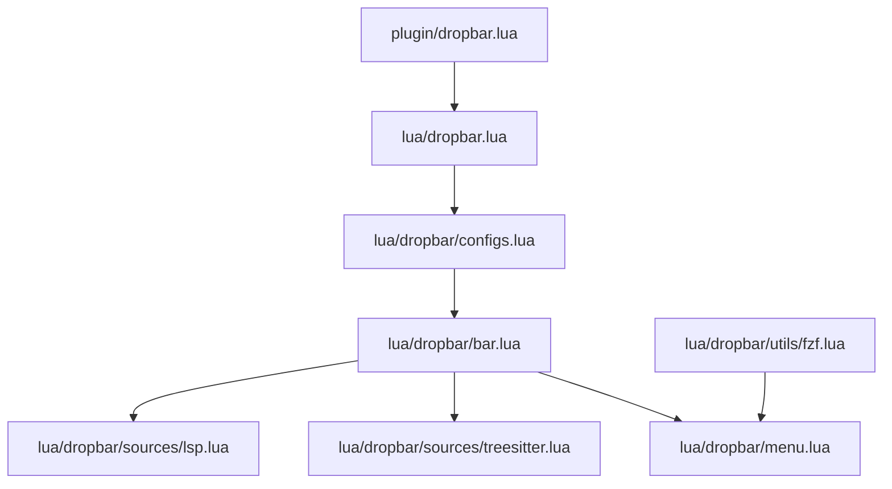

# Bekaboo/dropbar.nvim

> IDE-style breadcrumb bar for Neovim, with drop-down menus and several symbol sources.

## The problem
In Neovim, knowing where you are in a large file (class, function, heading) and navigating it remains impractical.

## What it actually does
plugin/dropbar.lua loads the main module, which applies configs.lua and builds the winbar in bar.lua. The latter queries sources (LSP, Tree-sitter, path, Markdown, terminal) in cascade and opens drop-down menus by mouse or keyboard, with optional fuzzy search (fzf). No mandatory dependency.

## How it is wired


## Trying it
```lua
require('lazy').setup({
  {
    'Bekaboo/dropbar.nvim',
    dependencies = { 'nvim-telescope/telescope-fzf-native.nvim', build = 'make' },
  }
})
```

## Cost and gotchas
Free, GPL-3.0. Requires Neovim 0.11+; a language server or a Tree-sitter parser must be installed for the symbols.

## What it is not
Not a file explorer nor an LSP: it displays the symbols that other components provide.

## Alternatives
No alternative named in the README.

## For you
Worth watching: pleasant if you navigate large Python files in Neovim, incidental otherwise.
