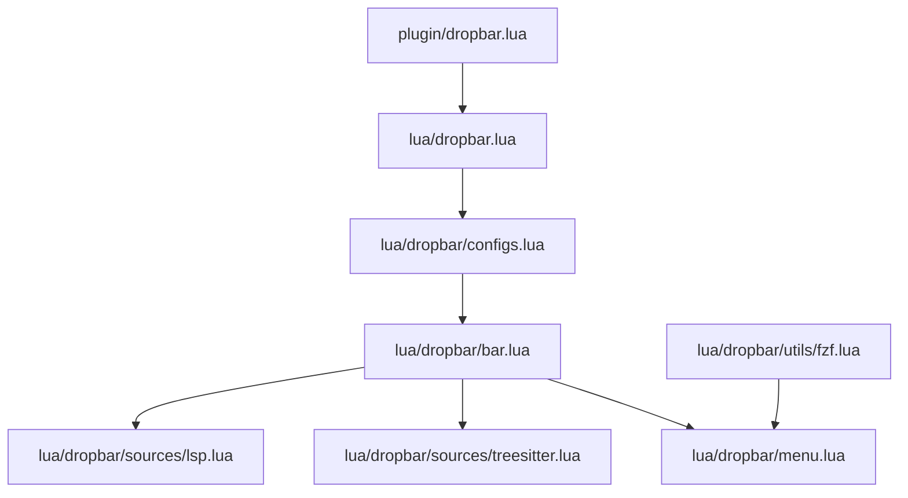

# Bekaboo/dropbar.nvim

> Barre de fil d'Ariane façon IDE pour Neovim, avec menus déroulants et plusieurs sources de symboles.

## Le problème
Dans Neovim, savoir où l'on se trouve dans un grand fichier (classe, fonction, titre) et y naviguer reste peu pratique.

## Ce que ça fait vraiment
plugin/dropbar.lua charge le module principal qui applique configs.lua et construit la winbar dans bar.lua. Celle-ci interroge des sources (LSP, Tree-sitter, chemin, Markdown, terminal) en cascade et ouvre des menus déroulants à la souris ou au clavier, avec recherche floue optionnelle (fzf). Sans dépendance obligatoire.

## Comment c'est branché


## Essayer
```lua
require('lazy').setup({
  {
    'Bekaboo/dropbar.nvim',
    dependencies = { 'nvim-telescope/telescope-fzf-native.nvim', build = 'make' },
  }
})
```

## Coût et pièges
Gratuit, GPL-3.0. Exige Neovim 0.11+ ; un serveur de langage ou un parseur Tree-sitter doit être installé pour les symboles.

## Ce que ce n'est pas
Ce n'est pas un explorateur de fichiers ni un LSP : il affiche les symboles que d'autres composants fournissent.

## Alternatives
Aucune alternative nommée dans le README.

## Pour toi
À surveiller : agréable si tu navigues de gros fichiers Python sous Neovim, anecdotique ailleurs.

