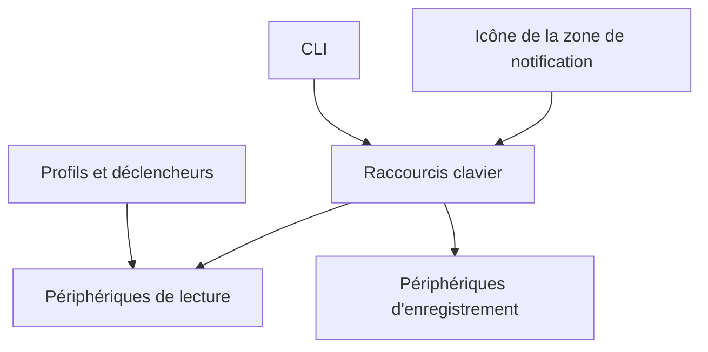

# Belphemur/SoundSwitch

> Windows application that switches audio devices with a keyboard shortcut, for any PC user.

## The problem
Changing audio output or input on Windows means going through several menus and screens.

## What it actually does
Stays in the notification area and cycles through playback devices (`Ctrl+Alt+F11`) or recording devices (`Ctrl+Alt+F7`), with microphone mute (`Ctrl+Alt+M`). Profiles switch device according to an application, a window, Steam Big Picture or startup. Notifications by banner, Windows or sound. A CLI and automatic update every 24 hours are added.

## How it is wired
Simplified diagram based on the sheet, no diagram provided.

## Trying it
No command documented in the README: install the application on Windows 10 or later, then right-click the notification area icon and open `Settings`.

## Cost and gotchas
Free. Windows 10 or later only (x64 or ARM64). Silent automatic update is a selectable mode: `Silent`, `Notify` or `Never`.

## What it is not
Not cross-platform: Windows only. Not a per-application audio mixer in the sense of an equalizer. Details of the CLI commands point to documentation not provided here.

## Alternatives
No alternative named in the README.

## For you
To ignore: Windows audio convenience utility, unrelated to data / AI / MLOps work.
