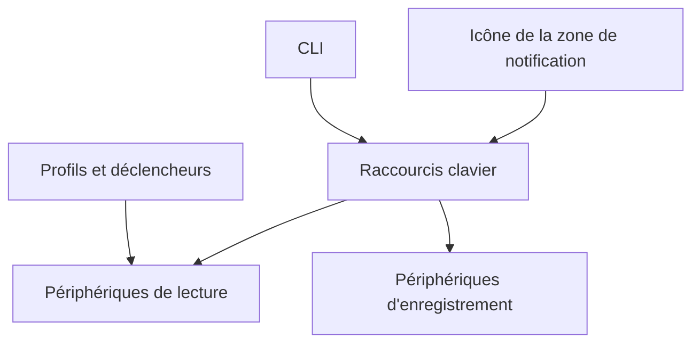

# Belphemur/SoundSwitch

> Application Windows qui bascule les périphériques audio par raccourci clavier, pour tout utilisateur de PC.

## Le problème
Changer de sortie ou d'entrée audio sous Windows oblige à passer par plusieurs menus et écrans.

## Ce que ça fait vraiment
Reste dans la zone de notification et fait défiler les périphériques de lecture (`Ctrl+Alt+F11`) ou d'enregistrement (`Ctrl+Alt+F7`), avec coupure du micro (`Ctrl+Alt+M`). Des profils changent d'appareil selon une application, une fenêtre, Steam Big Picture ou le démarrage. Notifications par bannière, Windows ou son. Une CLI et une mise à jour automatique toutes les 24 heures s'ajoutent.

## Comment c'est branché
Schéma simplifié d'après la fiche, sans diagramme fourni.

## Essayer
Aucune commande documentée dans le README : installer l'application sous Windows 10 ou plus récent, puis clic droit sur l'icône de la zone de notification et ouvrir `Settings`.

## Coût et pièges
Gratuit. Windows 10 ou plus récent seulement (x64 ou ARM64). La mise à jour automatique silencieuse est un mode au choix : `Silent`, `Notify` ou `Never`.

## Ce que ce n'est pas
Pas multiplateforme : Windows uniquement. Pas un mixeur audio par application au sens d'un égaliseur. Le détail des commandes de la CLI renvoie à une documentation non fournie ici.

## Alternatives
Aucune alternative nommée dans le README.

## Pour toi
À ignorer : utilitaire Windows de confort audio, sans lien avec un travail data / IA / MLOps.

