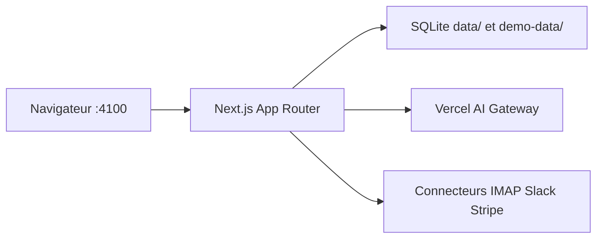

# Bennettxai/FounderOS-DEMO

> Next.js dashboard to manage the clients, finances and AI agents of a one-person business.

## The problem
A freelancer juggles CRM, mailbox, finances and social networks, with no overall view.

## What it actually does
A single Node application (Next.js 14, local SQLite) with a command center, client funnel, inbox, finances, social campaigns and an agent board. It starts in demo mode with a fictional company. The connectors (mail, Slack, Notion, Stripe) stay inactive without credentials. The agent chat goes through Vercel AI Gateway.

## How it is wired
Simplified diagram based on the fiche, no diagram provided.



## Trying it
```bash
git clone https://github.com/Bennettxai/FounderOS.git
cd FounderOS
npm ci
npm run dev
```

## Cost and gotchas
Demo needs no key. Real agents require `AI_GATEWAY_API_KEY`, on you. Node 22 required: Node 24 can crash `better-sqlite3`. No login by default (listens on 127.0.0.1).

## What it is not
This repository is a demo, not the full version (the clone points to FounderOS). Credentials stay local, but no security audit is documented.

## Alternatives
No alternative named in the README.

## For you
Ignore: a business management tool unrelated to data or MLOps; only the agent assembly deserves a glance.
