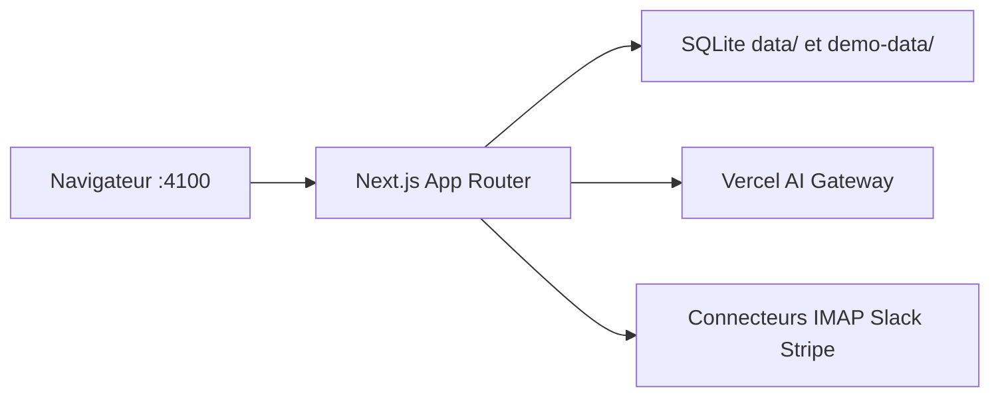

# Bennettxai/FounderOS-DEMO

> Tableau de bord Next.js pour gérer clients, finances et agents IA d'une entreprise d'une personne.

## Le problème
Un indépendant jongle entre CRM, boîte mail, finances et réseaux sociaux, sans vue d'ensemble.

## Ce que ça fait vraiment
Application Node unique (Next.js 14, SQLite locale) avec centre de commande, entonnoir clients, boîte de réception, finances, campagnes sociales et tableau d'agents. Elle démarre en mode démo avec une société fictive. Les connecteurs (mail, Slack, Notion, Stripe) restent inactifs sans identifiants. Le chat d'agents passe par Vercel AI Gateway.

## Comment c'est branché
Schéma simplifié d'après la fiche, sans diagramme fourni.



## Essayer
```bash
git clone https://github.com/Bennettxai/FounderOS.git
cd FounderOS
npm ci
npm run dev
```

## Coût et pièges
Démo sans clé. Les agents réels exigent `AI_GATEWAY_API_KEY`, à ta charge. Node 22 requis : Node 24 peut faire planter `better-sqlite3`. Aucun login par défaut (écoute sur 127.0.0.1).

## Ce que ce n'est pas
Ce dépôt est une démo, pas la version complète (le clone pointe vers FounderOS). Les identifiants restent en local, mais aucun audit de sécurité n'est documenté.

## Alternatives
Aucune alternative nommée dans le README.

## Pour toi
À ignorer : outil de gestion d'entreprise sans lien avec la data ou le MLOps ; seul l'assemblage d'agents mérite un coup d'œil.

