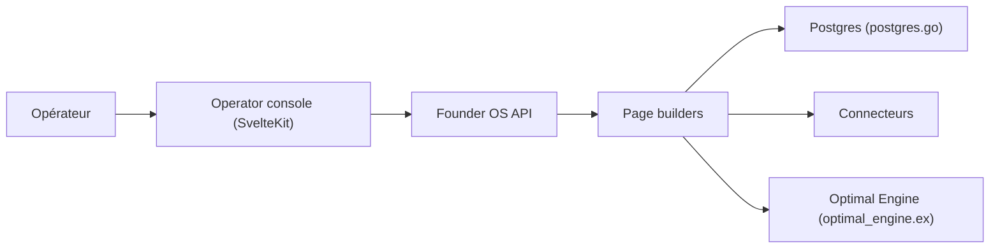

# Bennettxai/FounderOS

> Web console that organizes a one-person company into "departments" driven by AI agents.

## The problem
A solo founder juggles email, CRM, social networks, finances and notes across many tabs.

## What it actually does
- `/os` console: unified inbox, client funnel, workflows, social and content, finances, agents, tasks, knowledge base.
- v2 on the BusinessOS stack: SvelteKit, Go API (Gin), PostgreSQL and Redis, memory via Optimal Engine (Elixir).
- `make demo` loads demo data; 24 connectors show their real state (`connected`, `not_configured`, `error`).
- Outgoing writes and scheduled tasks disabled by default (`FOUNDEROS_WRITES`, `FOUNDEROS_CRONS`).

## How it is wired


## Trying it
```bash
brew install node@22 go postgresql@17 pgvector redis elixir python
BUSINESSOS_HEADLESS=1 make dev-local
make demo OWNER=you@example.com
open http://localhost:5273/os
```

## Cost and gotchas
Free, but you must install Node, Go, Postgres+pgvector, Redis, Elixir. The connectors require your own keys (`~/.founderos/.env`). The README promotes a paid training (cohort).

## What it is not
Not a ready-to-use SaaS: a self-hosted demo you have to set up. Depends on other projects (BusinessOS, Optimal Engine) mentioned in the credits.

## Alternatives
No alternative named in the README.

## For you
Ignore: heavy stack to host and oriented toward running a micro-business, far from a data/AI/MLOps need.
