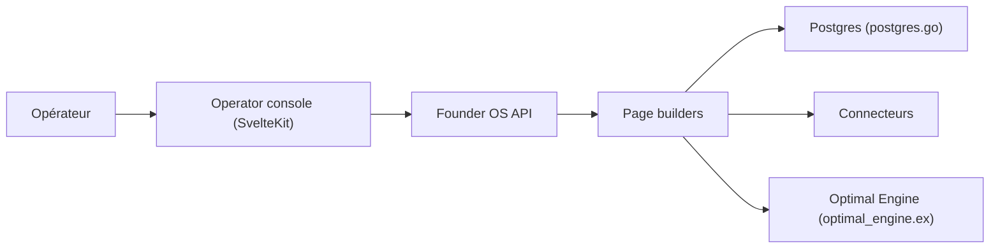

# Bennettxai/FounderOS

> Console web qui organise une entreprise individuelle en « départements » pilotés par des agents IA.

## Le problème
Un fondateur solo jongle entre mails, CRM, réseaux sociaux, finances et notes dans de nombreux onglets.

## Ce que ça fait vraiment
- Console `/os` : boîte unifiée, tunnel clients, workflows, social et contenu, finances, agents, tâches, base de connaissances.
- v2 sur la pile BusinessOS : SvelteKit, API Go (Gin), PostgreSQL et Redis, mémoire via Optimal Engine (Elixir).
- `make demo` charge des données de démonstration ; 24 connecteurs affichent leur état réel (`connected`, `not_configured`, `error`).
- Écritures sortantes et tâches planifiées désactivées par défaut (`FOUNDEROS_WRITES`, `FOUNDEROS_CRONS`).

## Comment c'est branché


## Essayer
```bash
brew install node@22 go postgresql@17 pgvector redis elixir python
BUSINESSOS_HEADLESS=1 make dev-local
make demo OWNER=you@example.com
open http://localhost:5273/os
```

## Coût et pièges
Gratuit, mais il faut installer Node, Go, Postgres+pgvector, Redis, Elixir. Les connecteurs demandent tes propres clés (`~/.founderos/.env`). Le README fait la promotion d'une formation payante (cohorte).

## Ce que ce n'est pas
Pas un SaaS prêt à l'emploi : une démo auto-hébergée à monter. Dépend d'autres projets (BusinessOS, Optimal Engine) mentionnés en crédits.

## Alternatives
Aucune alternative nommée dans le README.

## Pour toi
À ignorer : pile lourde à héberger et orientée gestion d'une micro-entreprise, loin d'un besoin data/IA/MLOps.

