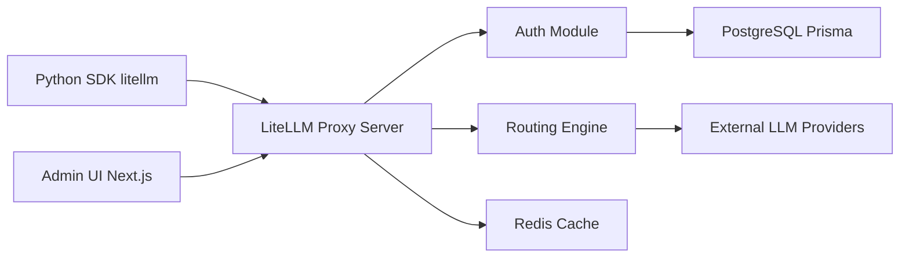

# BerriAI/litellm

> Python SDK and proxy gateway exposing 100+ LLM providers in the OpenAI format.

## The problem
Each LLM provider has its own SDK, auth, formats and errors; tracking costs and quotas per team becomes unmanageable.

## What it actually does
SDK: unified `completion(model="provider/model", ...)`, Router with retries/fallbacks, observability callbacks (Langfuse, MLflow…).
FastAPI proxy: virtual keys, spend tracking, guardrails, load balancing, Redis cache, Next.js dashboard, Postgres database via Prisma.
MCP and A2A gateways; chat, embeddings, images, audio, batches, rerank endpoints.
AWS/GCP Terraform modules; cosign-signed Docker images.

## How it is wired


## Trying it
```bash
uv add litellm
uv tool install 'litellm[proxy]'
litellm --model gpt-4o
docker-compose up db prometheus
```

## Cost and gotchas
Provider keys at your expense; Postgres/Redis for the full proxy. SSO and some features under a commercial Enterprise license. 5,203 open issues.

## What it is not
Not a model provider: a router. License not identified by GitHub, with a commercial part. The "8 ms P95" is a vendor figure.

## Alternatives
Not documented: no alternative repository named.

## For you
Adopt as an LLM abstraction layer in MLOps; check what falls under Enterprise.
