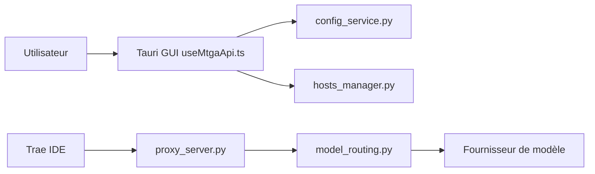

# BiFangKNT/mtga

> Local desktop proxy that redirects an IDE's (Trae) requests to the model provider of your choice.

## The problem
Some IDEs only accept their built-in model provider; you want to plug in your own API.

## What it actually does
Tauri application (Windows/macOS) that exposes a local OpenAI Chat Completions API. To intercept the IDE, it installs a certificate, edits the hosts file (`127.0.0.1 api.openai.com`) and listens on port 443. An internal layer, MLiteLLM, translates to OpenAI, Responses, Anthropic or Gemini.

## How it is wired

## Trying it
No command line: download the installer from the releases, add a configuration group, then "one key to start everything" in the interface.

## Cost and gotchas
Administrator rights required; root certificate and hosts modified; port 443 must be freed. The provider's API key is on you. README in Chinese.

## What it is not
Not a server-side LLM gateway: it is a local hijack for a specific IDE. AGPL license: obligations when redistributing.

## Alternatives
No alternative cited in the README.

## For you
Ignore: installing a root certificate and hijacking `api.openai.com` is intrusive; a real LLM gateway is preferable for serious use.
