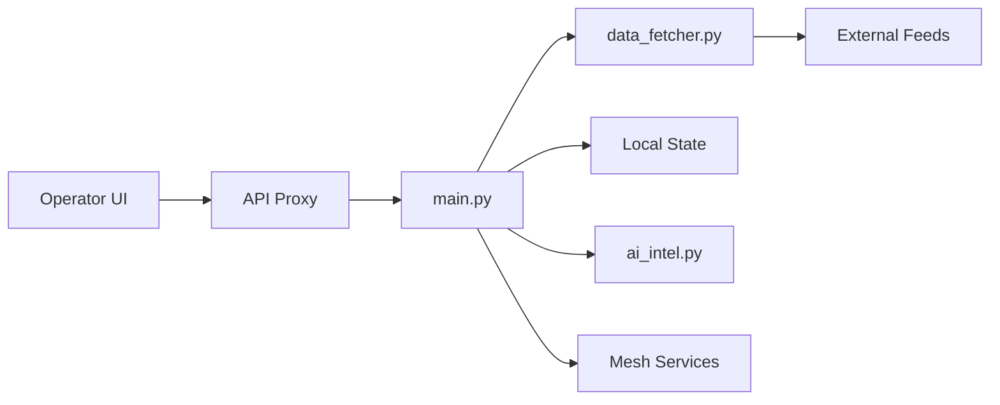

# BigBodyCobain/Shadowbroker

> Self-hosted map dashboard aggregating 60+ real-time OSINT feeds, with a channel for AI agents.

## The problem
Public data (ADS-B, AIS, satellites, earthquakes, cameras, radio) is scattered across dozens of tools and APIs.

## What it actually does
MapLibre map with 40+ layers: aircraft, ships, satellites, GDELT conflicts, CCTV, fires, GPS jamming, Shodan, Telegram OSINT, SAR…
FastAPI backend that polls sources in tiers, server-side recon toolkit (DNS, WHOIS, BGP, sanctions, CVE) with an SSRF guard.
HMAC-signed command channel for AI agents (reading, pins, map control), "Time Machine" replay.
Experimental InfoNet mesh network with governance, explicitly with no privacy guarantee.

## How it is wired


## Trying it
```bash
git clone https://github.com/bigbodycobain/Shadowbroker.git
cd Shadowbroker
docker compose pull
docker compose up -d
```

## Cost and gotchas
OpenSky, aisstream.io, CARTO keys and optionally Shodan, GFW, Earthdata; backend capped at 4 GB and prone to OOM.
Many outgoing requests to the enabled providers.

## What it is not
Not a private messenger: InfoNet is a testnet without end-to-end encryption.
Sensitive use (tracking people, cameras, scanners): the legal framework is your responsibility.

## Alternatives
No alternative named in the README (OSIRIS is a source of reused code, not an alternative).

## For you
Ignore for a data/MLOps profile: a spectacular project but run by one person, experimental, and with no ML use beyond the agent channel.
