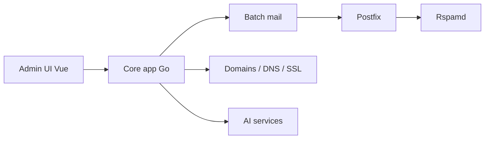

# Billionmail/BillionMail

> Self-hosted mail server and emailing platform; apparent duplicate of the aaPanel/BillionMail repository.

## The problem
Emailing platforms are expensive or closed, and a mail server is hard to set up by hand.

## What it actually does
The README is identical to that of aaPanel/BillionMail (same commands that clone `aaPanel/BillionMail`). From the code: Postfix, Dovecot, Rspamd and `core` containers (Go backend), a Vue admin interface, batch sending, contacts, domains/DNS/SSL, RBAC, logs, fail2ban, an AI module (OpenAI, Anthropic, Gemini, DeepSeek…) and a video generation module.

## How it is wired


## Trying it
```bash
cd /opt && git clone https://github.com/aaPanel/BillionMail && cd BillionMail && bash install.sh
bm help
```

## Cost and gotchas
IP, DNS and sending reputation are on you. AGPL-3.0 license. API keys for the AI providers must be supplied for those modules. The README commands point to the aaPanel repository, not this one.

## What it is not
Not a proven distinct project: the relationship with aaPanel/BillionMail is not explained. The AI and video modules come from the code, not the README.

## Alternatives
No alternative named. The aaPanel/BillionMail repository is the source cited by the commands.

## For you
Keep an eye on it: same reservations as the original; start by establishing which repository is authoritative before evaluating it.
