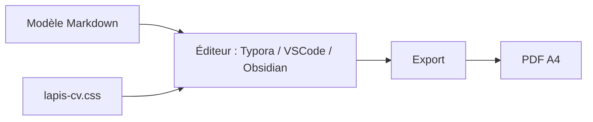

# BingyanStudio/LapisCV

> CSS themes for writing a CV in Markdown in Typora, VSCode or Obsidian and exporting it to PDF.

## The problem
Laying out a polished CV in Word is slow and hard to version.

## What it actually does
Provides `lapis-cv.css` and `lapis-cv-serif.css` themes, a CV template, icons by Unicode code and style variables (sizes, fonts, colors). The PDF comes out through Typora's export, the VSCode Markdown PDF extension or Obsidian. Page break with `---`.

## How it is wired


## Trying it
```bash
git clone git@github.com:BingyanStudio/LapisCV.git
cd LapisCV
make
ls build
```

## Cost and gotchas
Free. Export settings are manual (A4, margins). Some VSCode extensions can disturb the styling; Obsidian does not handle page numbers or local images in HTML.

## What it is not
Not an online CV generator nor an editor: only styles and a template.

## Alternatives
No alternative named in the README.

## For you
Ignore unless you want a versioned Markdown CV: useful but unrelated to data/AI.
