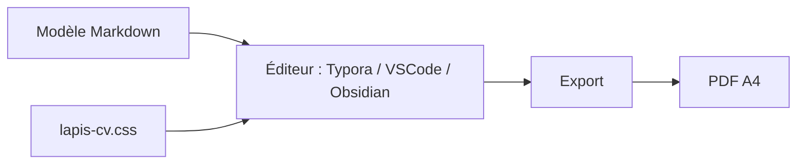

# BingyanStudio/LapisCV

> Thèmes CSS pour écrire un CV en Markdown dans Typora, VSCode ou Obsidian et l'exporter en PDF.

## Le problème
Mettre en page un CV soigné dans Word est long et peu versionnable.

## Ce que ça fait vraiment
Fournit des thèmes `lapis-cv.css` et `lapis-cv-serif.css`, un modèle de CV, des icônes par code Unicode et des variables de style (tailles, polices, couleurs). Le PDF sort via l'export de Typora, l'extension Markdown PDF de VSCode ou Obsidian. Saut de page par `---`.

## Comment c'est branché


## Essayer
```bash
git clone git@github.com:BingyanStudio/LapisCV.git
cd LapisCV
make
ls build
```

## Coût et pièges
Gratuit. Réglages d'export manuels (A4, marges). Des extensions VSCode peuvent perturber le style ; Obsidian ne gère pas les numéros de page ni les images locales en HTML.

## Ce que ce n'est pas
Pas un générateur de CV en ligne ni un éditeur : seulement des styles et un modèle.

## Alternatives
Aucune alternative nommée dans le README.

## Pour toi
À ignorer sauf si tu veux un CV en Markdown versionné : utile mais sans lien avec data/IA.

