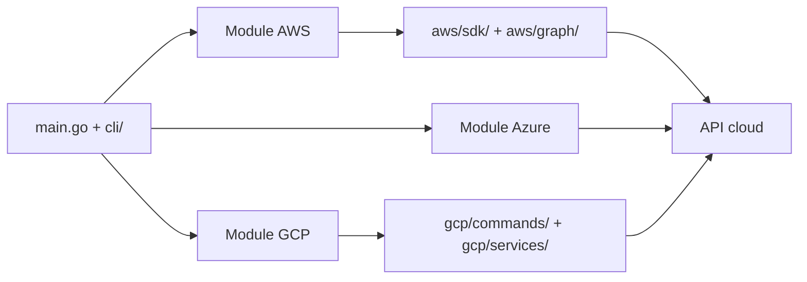

# BishopFox/cloudfox

> Command-line tool that maps an AWS, Azure or GCP environment for authorized security auditors.

## The problem
A cloud penetration test often starts in an unknown account: which regions, which resources, which roles, which exposed secrets? Listing everything by hand in the console is slow.

## What it actually does
- Enumerates an account's resources read-only (instances, buckets, functions, secrets, roles, endpoints) and writes tables and "loot" files.
- Covers AWS (the most complete), GCP (about fifty commands) and Azure (a few commands: whoami, inventory, rbac, storage, vms).
- An `all-checks` command chains the AWS commands with default settings.
- Produces neither alerts nor a compliance score: it supplies material to the auditor, and deliberately avoids automated exploitation.

## How it is wired


## Trying it
```bash
brew install cloudfox
cloudfox aws --profile [profile-name] all-checks
```

## Cost and gotchas
Free, but you need cloud credentials with read permissions (`SecurityAudit` policy + CloudFox policy for AWS; `roles/viewer` and above for GCP). Versions before 1.17.0 no longer work (AWS format change, 12/2025). Use only on accounts you have written authorization for.

## What it is not
Neither a compliance tool (see ScoutSuite, Prowler), nor an exploitation framework. Errors are frequent if permissions are missing; they are logged in `~/.cloudfox/cloudfox-error.log`. Azure remains thinly covered (README: storage "in development").

## Alternatives
- ScoutSuite / Prowler: compliance benchmarks, if you want findings rather than enumeration.
- Pacu: adds exploitation automation, which CloudFox avoids.
- Steampipe: query all your cloud resources in SQL, outside an offensive context.

## For you
Watch: useful if you audit a cloud's surface (overly broad permissions on ML pipeline roles, secrets in environment variables), but it is a pentest tool, not part of your daily data/MLOps work.
