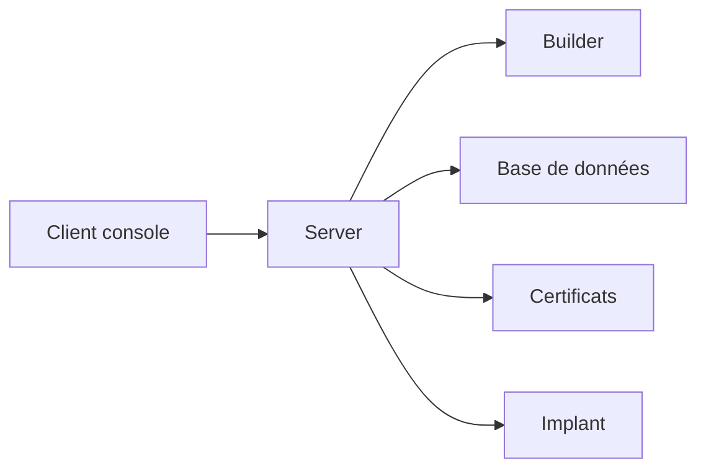

# BishopFox/sliver

> Cross-platform adversary emulation framework for red teams, used in authorized security testing.

## The problem
Organizations testing their defenses need a framework that reproduces adversary behavior, under contract, to check detection and response.

## What it actually does
A server / client / implant architecture: the server (RPC, database, certificates, generator) is driven by a console, in multiplayer mode. Communications support mTLS, WireGuard, HTTP(S) and DNS. It runs on macOS, Windows and Linux, and is scriptable in Python. The README also mentions a DNS canary for defensive detection. The details of the offensive capabilities are not reproduced here.

## How it is wired
The README provides no readable graph components; diagram based on the architecture described.


## Trying it
```bash
curl https://sliver.sh/install|sudo bash
sliver
```
A piped-to-shell script should be reviewed before running.

## Cost and gotchas
Free. GPL-3.0 license (copyleft). Use is lawful only within an authorized contractual framework, on systems for which you have explicit consent. The traffic may trigger security alerts.

## What it is not
It is not a data or AI tool, nor a vulnerability scanner. Nor is it a product for use without authorization.

## Alternatives
No alternative named in the README.

## For you
Ignore for a data / AI / MLOps profile: it is a red team tool unrelated to your daily work, and its use requires a strict legal framework.
