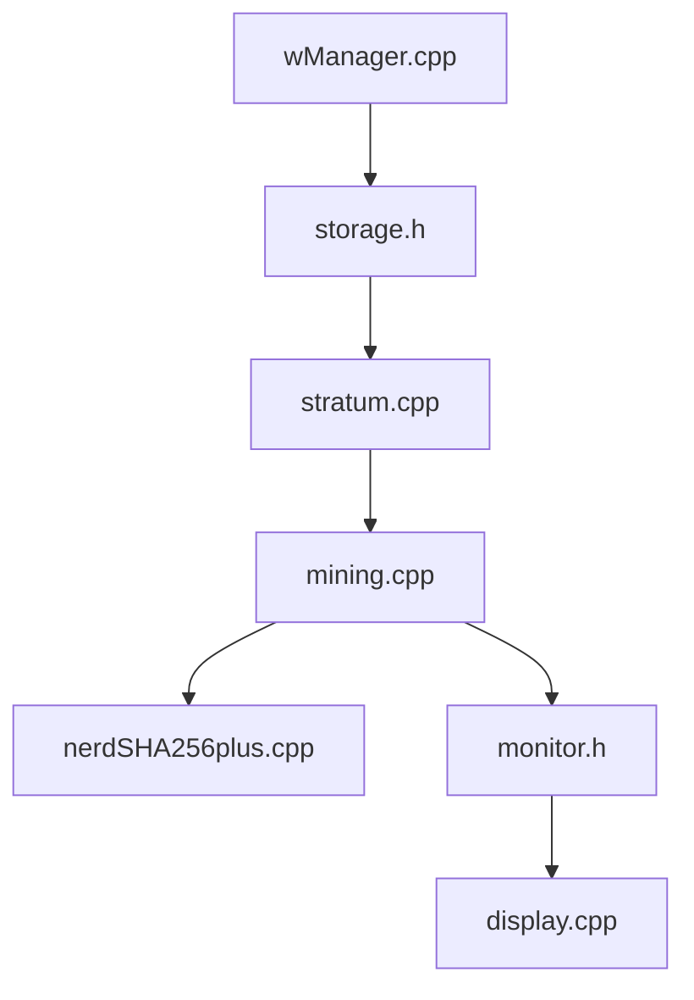

# BitMaker-hub/NerdMiner_v2

> ESP32 firmware that solo-mines Bitcoin via Stratum, for learning and desk decoration.

## The problem
Understanding mining without buying an ASIC; looking for a small educational object.

## What it actually does
ESP32 firmware (T-Display S3 and other boards) that connects to a Stratum pool and computes SHA-256 hashes on both cores. Screens: mining, clock, global statistics. Wi-Fi and BTC address configuration via an access point, or `config.json` on an SD card.

## How it is wired
Diagram based on the code's diagram.



## Trying it
```bash
# README : pas de commande shell. Flasher via https://flasher.bitronics.store/
# ou esptool avec les binaires du dossier bin.
# Se connecter au point d'accès NerdMinerAP, saisir Wi-Fi et adresse BTC.
```

## Cost and gotchas
You need to buy an ESP32 board. Conventional pools reject low difficulty: use a compatible pool. A license is present but unidentified.

## What it is not
Not a way to make money: the probability of finding a block is almost zero. A default access-point password is published in the README.

## Alternatives
The original project valerio-vaccaro/HAN, cited in the README.

## For you
Ignore: educational toy on a microcontroller, unrelated to data/AI/MLOps.
