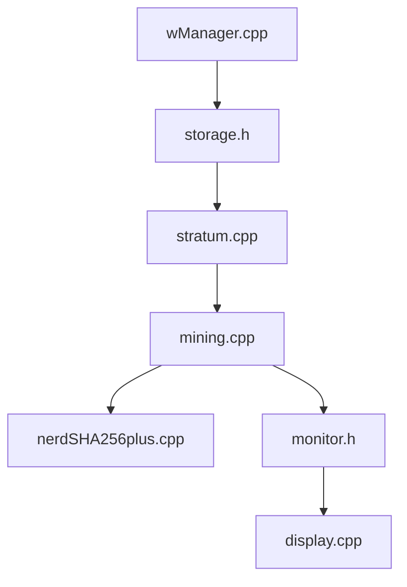

# BitMaker-hub/NerdMiner_v2

> Firmware ESP32 qui mine du Bitcoin en solo via Stratum, pour apprendre et décorer un bureau.

## Le problème
Comprendre le minage sans acheter un ASIC ; on cherche un petit objet pédagogique.

## Ce que ça fait vraiment
Firmware ESP32 (T-Display S3 et autres cartes) qui se connecte à un pool Stratum et calcule des hachages SHA-256 sur les deux cœurs. Écrans : minage, horloge, statistiques globales. Configuration Wi-Fi et adresse BTC via un point d'accès, ou `config.json` sur carte SD.

## Comment c'est branché
Schéma d'après le diagramme du code.



## Essayer
```bash
# README : pas de commande shell. Flasher via https://flasher.bitronics.store/
# ou esptool avec les binaires du dossier bin.
# Se connecter au point d'accès NerdMinerAP, saisir Wi-Fi et adresse BTC.
```

## Coût et pièges
Il faut acheter une carte ESP32. Les pools classiques refusent la faible difficulté : utiliser un pool compatible. Licence présente mais non identifiée.

## Ce que ce n'est pas
Pas un moyen de gagner de l'argent : la probabilité de trouver un bloc est quasi nulle. Un mot de passe par défaut du point d'accès est publié dans le README.

## Alternatives
Projet original valerio-vaccaro/HAN, cité dans le README.

## Pour toi
À ignorer : jouet pédagogique sur microcontrôleur, sans lien avec data/IA/MLOps.

