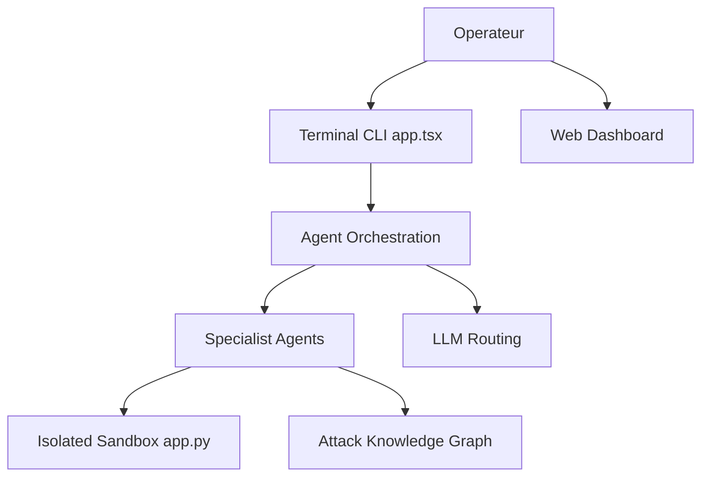

# BitterSecurity/Decepticon

> Autonomous red team agent (authorized penetration testing) driving specialized agents in a Docker sandbox.

## The problem
Red team engagements require a lot of manual work and varied tools. Scanners alone do not chain the steps of a realistic scenario.

## What it actually does
An operator names a web target; the launcher creates the rules of engagement (RoE) and the approval. 16 specialized agents (reconnaissance, vulnerabilities, Active Directory, cloud, reverse engineering...) work in an isolated Kali sandbox, with persistent shells. A Neo4j knowledge graph and a web dashboard keep results and context. A "Blue Cell" component observes locally and flags incidents, without blocking traffic.

## How it is wired


## Trying it
```bash
curl -fsSL https://decepticon.red/install | bash
decepticon onboard
decepticon
```

## Cost and gotchas
Docker and Docker Compose v2 required; an API key from an LLM provider (or OAuth subscription) at your expense. A hosted cloud version exists. The install script is run via `curl | bash`.

## What it is not
Not a passive scanner: the tool performs real offensive actions. Its use is legal only on systems for which you have the owner's written authorization (the README reminds of this). The "Offensive Vaccine" loop is only planned.

## Alternatives
- Strix, PentestGPT, MAPTA, Cyber-AutoAgent: AI pentest agents cited in the README, compared by the author.

## For you
Keep an eye on it: interesting as an example of multi-agent LLM orchestration with a sandbox, but without an authorized security mission it has no direct use for a data / AI / MLOps profile.
