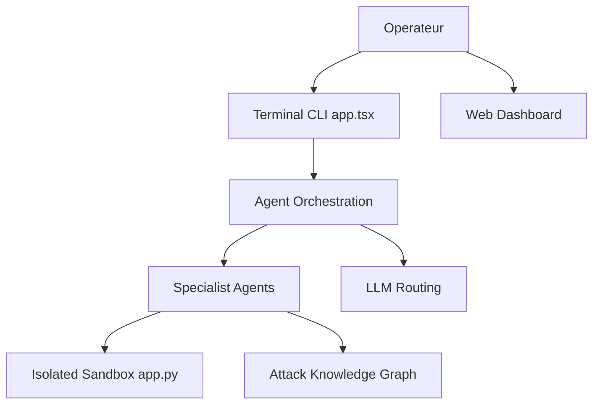

# BitterSecurity/Decepticon

> Agent autonome de red team (tests d'intrusion autorisés) pilotant des agents spécialisés dans un bac à sable Docker.

## Le problème
Les engagements de red team demandent beaucoup de travail manuel et d'outils variés. Les scanners seuls ne enchaînent pas les étapes d'un scénario réaliste.

## Ce que ça fait vraiment
Un opérateur indique une cible web ; le lanceur crée les règles d'engagement (RoE) et l'approbation. 16 agents spécialisés (reconnaissance, vulnérabilités, Active Directory, cloud, rétro-ingénierie…) travaillent dans un bac à sable Kali isolé, avec shells persistants. Un graphe de connaissances Neo4j et un tableau de bord web conservent résultats et contexte. Un volet « Blue Cell » observe localement et signale des incidents, sans bloquer le trafic.

## Comment c'est branché


## Essayer
```bash
curl -fsSL https://decepticon.red/install | bash
decepticon onboard
decepticon
```

## Coût et pièges
Docker et Docker Compose v2 requis ; clé d'API d'un fournisseur LLM (ou abonnement OAuth) à ta charge. Une version cloud hébergée existe. Le script d'installation est exécuté via `curl | bash`.

## Ce que ce n'est pas
Pas un scanner passif : l'outil exécute des actions offensives réelles. Son usage n'est légal que sur des systèmes dont tu as l'autorisation écrite du propriétaire (le README le rappelle). La boucle « Offensive Vaccine » est seulement planifiée.

## Alternatives
- Strix, PentestGPT, MAPTA, Cyber-AutoAgent : agents de pentest IA cités dans le README, comparés par l'auteur.

## Pour toi
À surveiller : intéressant comme exemple d'orchestration multi-agents LLM avec sandbox, mais sans mission de sécurité autorisée il n'a pas d'usage direct pour un profil data / IA / MLOps.

