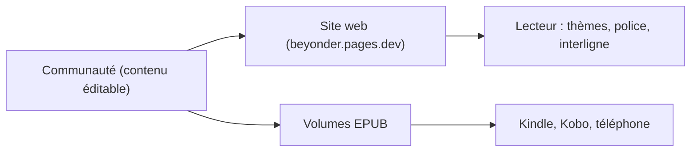

# Bittu5134/LOTM-Reader

> Reading site for fan translations of the novel Lord of the Mysteries, with downloadable EPUBs.

## The problem
Reading the series online or offline in a comfortable reader, without ads.

## What it actually does
- Website (beyonder.pages.dev) with themes, illustrations and reading settings (font, line spacing).
- Complete volumes as EPUB for Kindle, Kobo or phone.
- Community-editable content; no trackers or ads according to the README.
- Architecture not provided: no code diagram.

## How it is wired
Simplified diagram based on the fiche, no diagram provided.

## Trying it
No command: open the site or the EPUB download page from the README.

## Cost and gotchas
Free. The content is an unofficial translation: risk of takedown for copyright infringement (the README mentions DMCA information).

## What it is not
Not an official edition: the author states they do not hold the rights. The site engine is MIT, but the license detected by GitHub is not identified.

## Alternatives
- Official English translation on Webnovel, cited in the README.

## For you
Ignore: unofficial fan translations, no value for data / AI / MLOps and with a legal risk.
