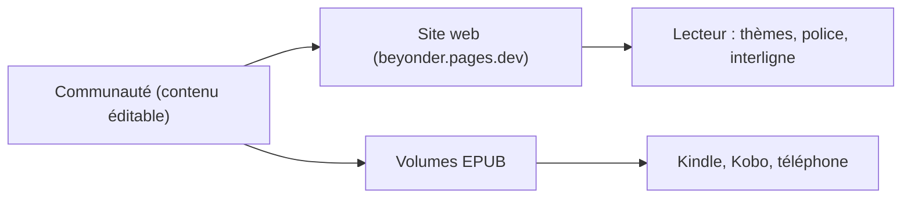

# Bittu5134/LOTM-Reader

> Site de lecture de traductions de fans du roman Lord of the Mysteries, avec EPUB téléchargeables.

## Le problème
Lire la série en ligne ou hors ligne dans un lecteur confortable, sans publicité.

## Ce que ça fait vraiment
- Site web (beyonder.pages.dev) avec thèmes, illustrations et réglages de lecture (police, interligne).
- Volumes complets en EPUB pour Kindle, Kobo ou téléphone.
- Contenu éditable par la communauté ; aucun traceur ni publicité selon le README.
- Architecture non fournie : aucun diagramme de code.

## Comment c'est branché
Schéma simplifié d'après la fiche, sans diagramme fourni.

## Essayer
Aucune commande : ouvrir le site ou la page de téléchargement EPUB depuis le README.

## Coût et pièges
Gratuit. Le contenu est une traduction non officielle : risque de retrait pour atteinte au droit d'auteur (le README parle d'informations DMCA).

## Ce que ce n'est pas
Pas une édition officielle : l'auteur affirme ne pas détenir les droits. Le moteur du site est en MIT, mais la licence détectée par GitHub n'est pas identifiée.

## Alternatives
- Traduction officielle anglaise sur Webnovel, citée dans le README.

## Pour toi
À ignorer : traductions de fans non officielles, sans valeur pour data / IA / MLOps et avec un risque juridique.

