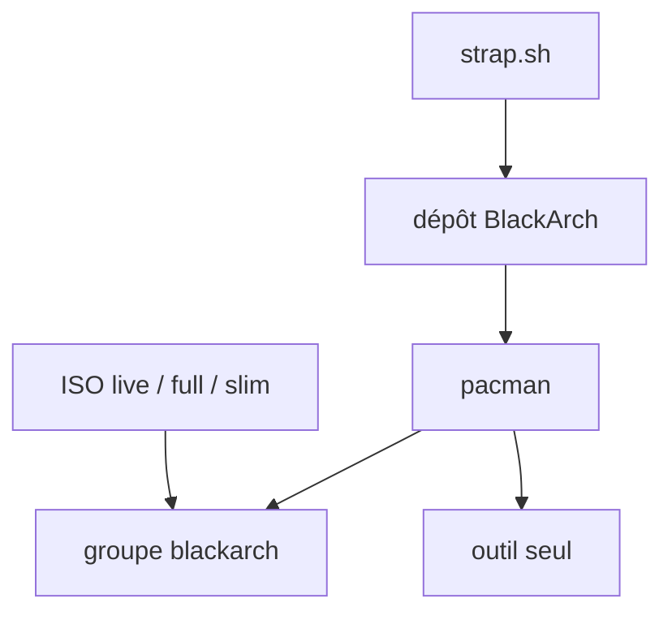

# BlackArch/blackarch

> Repository of more than 2,800 penetration testing tools for Arch Linux, for pentesters and security researchers.

## The problem
Gathering and cleanly installing hundreds of scattered security tools, with their dependencies.

## What it actually does
Provides a pacman package repository, installable one by one or by groups (`blackarch-webapp`, for example). Also available as a live ISO, full (text installer), netinstall or slim (graphical installer). Compatible with an existing Arch installation.

## How it is wired
Simplified diagram based on the sheet, no diagram provided.


## Trying it
```bash
curl -s https://blackarch.org/strap.sh | sudo bash
sudo pacman -S blackarch
sudo pacman -S blackarch-webapp
pacman -Sg blackarch
```

## Cost and gotchas
Free. Installing the whole `blackarch` group takes a lot of disk space. The `strap.sh` script is run as root from the network.

## What it is not
Not a single tool: a catalogue of packages. Reserved for ethical use, on authorized systems. The repository contains the package recipes, not the tools themselves.

## Alternatives
No alternative named in the README.

## For you
Ignore: offensive security on Arch, unrelated to data / AI / MLOps work, except for an occasional security audit.
