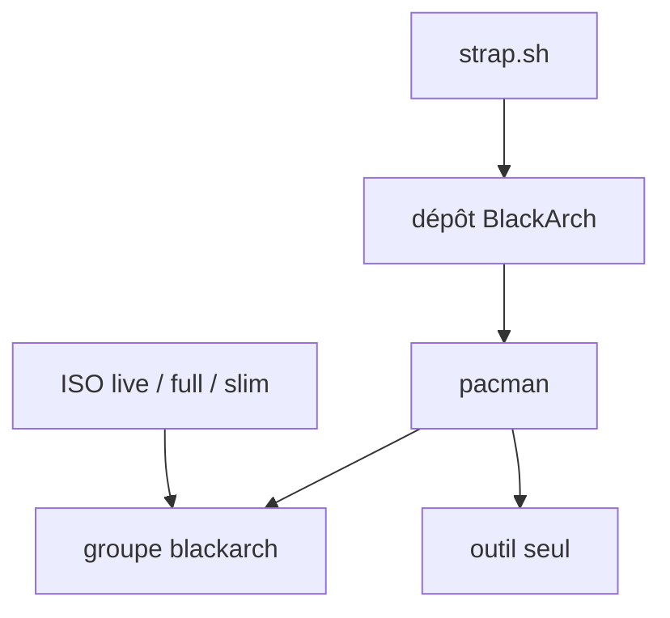

# BlackArch/blackarch

> Dépôt de plus de 2 800 outils de test d'intrusion pour Arch Linux, pour pentesters et chercheurs en sécurité.

## Le problème
Réunir et installer proprement des centaines d'outils de sécurité dispersés, avec leurs dépendances.

## Ce que ça fait vraiment
Fournit un dépôt de paquets pacman, installables à l'unité ou par groupes (`blackarch-webapp`, par exemple). Existe aussi en ISO live, complète (installeur texte), netinstall ou slim (installeur graphique). Compatible avec une installation Arch existante.

## Comment c'est branché
Schéma simplifié d'après la fiche, sans diagramme fourni.


## Essayer
```bash
curl -s https://blackarch.org/strap.sh | sudo bash
sudo pacman -S blackarch
sudo pacman -S blackarch-webapp
pacman -Sg blackarch
```

## Coût et pièges
Gratuit. Installer tout le groupe `blackarch` pèse lourd en disque. Le script `strap.sh` est exécuté en root depuis le réseau.

## Ce que ce n'est pas
Pas un seul outil : un catalogue de paquets. Réservé à un usage éthique, sur des systèmes autorisés. Le dépôt contient les recettes de paquets, non les outils eux-mêmes.

## Alternatives
Aucune alternative nommée dans le README.

## Pour toi
À ignorer : sécurité offensive sur Arch, sans rapport avec un travail data / IA / MLOps, sauf audit de sécurité ponctuel.

