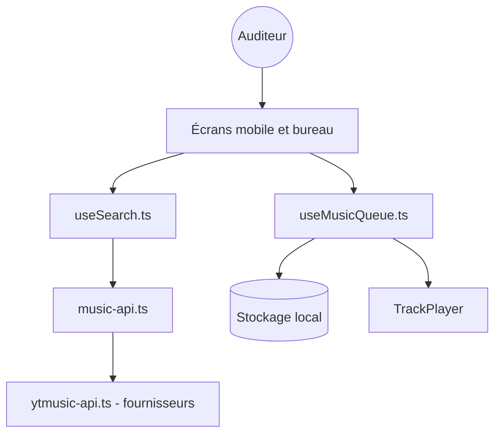

# BlackHatDevX/openspot-music-app

> Two music streaming apps, mobile and desktop, free, no account, drawing on third-party catalogs.

## The problem
Listening to and downloading music without a subscription, without ads and without creating an account.

## What it actually does
Two independent apps in a monorepo: mobile (React Native + Expo) and desktop (Tauri + React). Search for tracks, albums and artists, a saved play queue, likes, custom playlists, offline downloads, import of a public Spotify playlist, trends by region via IPinfo. The catalogs come from external providers (`ytmusic-api.ts` modules, Saavn endpoint).

## How it is wired

## Trying it
No documented command: the README points to a download link for version 3.1.5.

## Cost and gotchas
Free, no account. Depends on unofficial streaming sources: availability and legality are not guaranteed. The README does not state where the audio files come from.

## What it is not
It is not a licensed streaming service with official catalogs. The repository contains no music; it aggregates third-party APIs that may change or shut down.

## Alternatives
No alternative named in the README.

## For you
Ignore: a consumer music player, irrelevant to data, AI or MLOps, and fragile both on rights and on third-party APIs.
