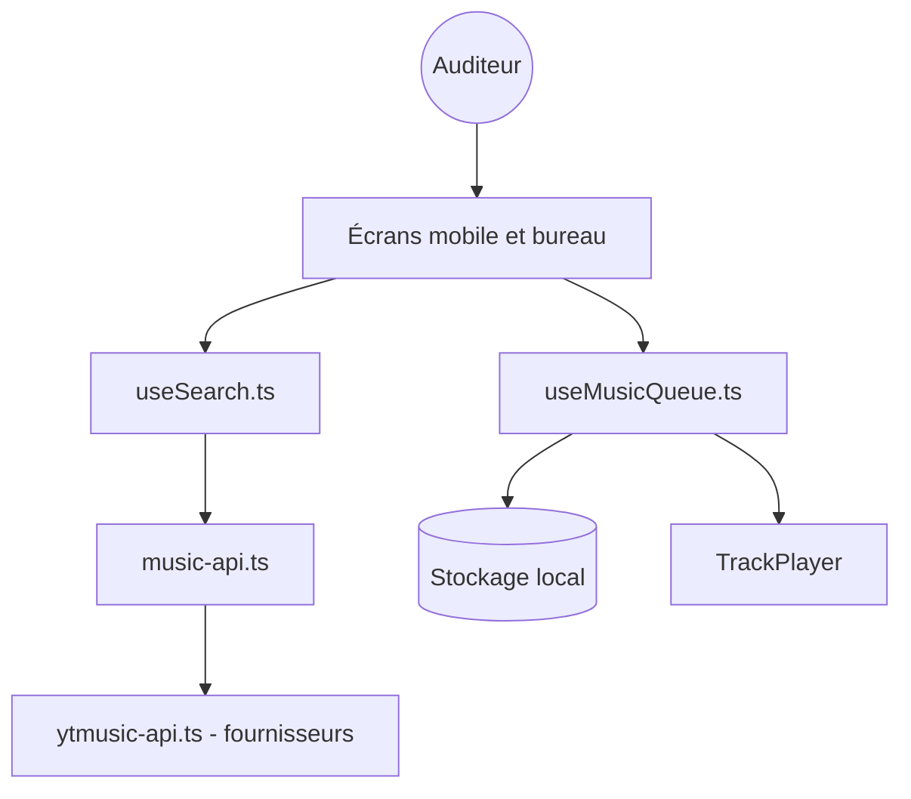

# BlackHatDevX/openspot-music-app

> Deux applications de streaming musical, mobile et bureau, gratuites, sans compte, qui puisent dans des catalogues tiers.

## Le problème
Écouter et télécharger de la musique sans abonnement, sans publicité et sans créer de compte.

## Ce que ça fait vraiment
Deux applications indépendantes dans un monorepo : mobile (React Native + Expo) et bureau (Tauri + React). Recherche de titres, albums et artistes, file de lecture sauvegardée, likes, listes personnalisées, téléchargements hors ligne, import d'une liste Spotify publique, tendances par région via IPinfo. Les catalogues viennent de fournisseurs externes (modules `ytmusic-api.ts`, point d'accès Saavn).

## Comment c'est branché

## Essayer
Aucune commande documentée : le README renvoie vers un lien de téléchargement de la version 3.1.5.

## Coût et pièges
Gratuit, sans compte. Dépend de sources non officielles de streaming : disponibilité et légalité non garanties. Le README ne précise pas la provenance des fichiers audio.

## Ce que ce n'est pas
Ce n'est pas un service de streaming sous licence avec les catalogues officiels. Le dépôt ne contient aucune musique ; il agrège des API tierces susceptibles de changer ou de fermer.

## Alternatives
Aucune alternative nommée dans le README.

## Pour toi
À ignorer : un lecteur musical grand public, sans pertinence pour data, IA ou MLOps, et fragile sur le plan des droits comme des API tierces.

