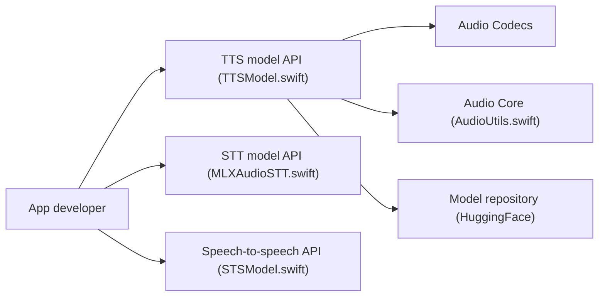

# Blaizzy/mlx-audio-swift

> Modular Swift SDK for speech synthesis, transcription and audio processing with MLX on Apple Silicon.

## The problem
Running TTS, STT or diarization locally in an Apple app requires porting each model by hand.

## What it actually does
Swift modules to import à la carte: MLXAudioCore, Codecs (SNAC, Encodec, Mimi…), TTS (Soprano, Qwen3-TTS, Orpheus, Fish Audio…), STT (Whisper, Parakeet, Qwen3-ASR…), VAD/diarization (Sortformer, Silero), speech-to-speech and SwiftUI components. Models are downloaded from HuggingFace; asynchronous generation and streaming.

## How it is wired


## Trying it
```bash
git clone https://github.com/Blaizzy/mlx-audio-swift.git
```
The README adds the dependency `.package(url: "https://github.com/Blaizzy/mlx-audio-swift.git", branch: "main")` in Package.swift.

## Cost and gotchas
macOS 14+ or iOS 17+, Xcode 15+, Swift 5.9+, Apple Silicon recommended. Dependency on the `main` branch, with no pinned version.

## What it is not
No Python version and no Linux; the model tables sometimes list "compatible" checkpoints without a specific repo.

## Alternatives
- MLX Audio (Python): the project this one is inspired by, for use outside Swift.

## For you
Worth watching if you build local audio apps on Mac or iOS; otherwise of little use, since it is Swift and Apple Silicon only.
