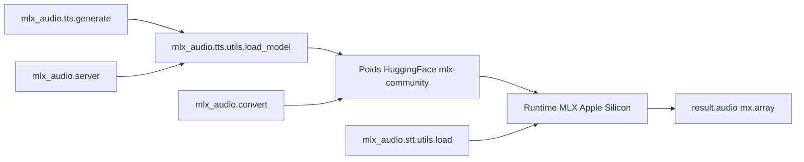

# Blaizzy/mlx-audio

> Audio library on MLX: TTS, STT, separation and music generation on Apple Silicon.

## The problem
Running decent TTS or ASR locally on a Mac means converting each model, writing your own loader,
and starting over for the next one.

## What it actually does
A single entry point, `load_model(...)` then `generate(...)`, for about thirty architectures:
Kokoro, Qwen3-TTS, Higgs Audio, OmniVoice, Voxtral, MOSS-TTS on the synthesis side; Whisper,
Parakeet, Qwen3-ASR, VibeVoice-ASR on the transcription side, with diarization and timestamps.
Also text-guided source separation (SAM-Audio), denoising, VAD and music generation. 3 to 8 bit
quantization through `mlx_audio.convert`. OpenAI-compatible API server and web interface.

## How it is wired


## Trying it
```bash
pip install mlx-audio
uv tool install --force mlx-audio --prerelease=allow
mlx_audio.tts.generate --model mlx-community/Qwen3-TTS-12Hz-0.6B-CustomVoice-8bit --text 'Hello, world!' --voice Vivian
mlx_audio.server --host 0.0.0.0 --port 8000
python -m mlx_audio.convert --hf-path prince-canuma/Kokoro-82M --mlx-path ./Kokoro-82M-4bit --quantize --q-bits 4
```

## Cost and gotchas
Apple Silicon Mac required (M1 to M4), Python 3.10+. ffmpeg required for MP3/FLAC/OGG/Opus.
Some models are heavy: KugelAudio announces ~17 GB of memory in bfloat16. Kokoro requires
`pip install misaki`, with per-language extras. The README is truncated before the end.

## What it is not
It is not portable: no CUDA, no Linux. It is not a training engine. KugelAudio does not yet have
upstream voice presets: default voice only.

## Alternatives
- **mlx-audio-swift**: for embedded iOS/macOS TTS without going through Python.

## For you
The reference if you work on audio locally on a Mac; adopt it to transcribe and synthesize.
