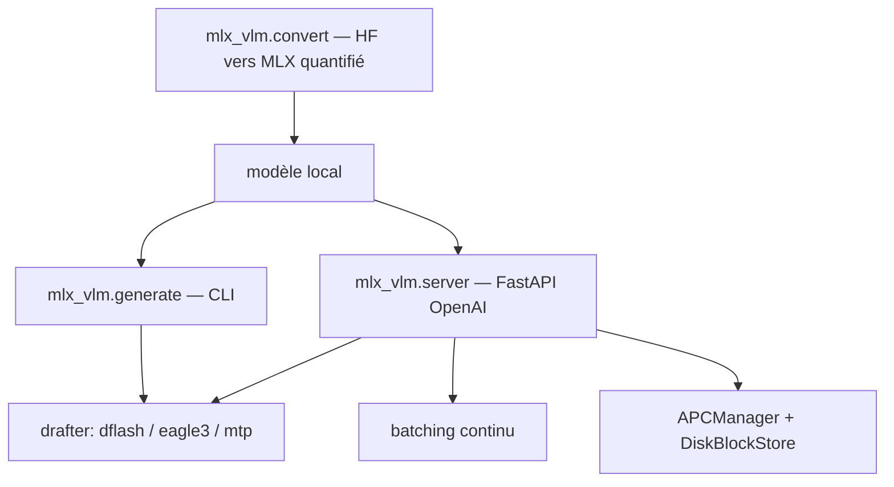

# Blaizzy/mlx-vlm

> Inference and fine-tuning of vision-language and omni models on Mac, via MLX.

## The problem
Running a VLM on Apple Silicon means converting the weights, adapting the chat template and managing the KV cache by hand. Each new architecture breaks the chain again.

## What it actually does
A CLI (`mlx_vlm.generate`), an OpenAI-compatible FastAPI server and a Python API cover text, image, audio, video and speech generation, with more than thirty documented models (DeepSeek-OCR, Gemma 4, MiniCPM-o, Qwen, MiniMax M3).
Speculative decoding is industrialized: three families of drafters (`dflash`, `eagle3`, `mtp`), auto-detection of published checkpoints, and measured speedups of up to 3.94× on Gemma 4 26B-A4B with identical output under greedy decoding.
Automatic prefix caching (APC) reuses state across requests sharing a prefix, in warm memory or persisted to disk as safetensors, with a layer-group cache plan inspired by vLLM.
The server does continuous batching, quantizes the KV cache (uniform or TurboQuant, separate bits for keys/values) and logs TTFT and throughput.

## How it is wired


## Trying it
```bash
pip install -U mlx-vlm
mlx_vlm.generate --model mlx-community/Qwen2-VL-2B-Instruct-4bit --max-tokens 100 --temperature 0.0 --image http://images.cocodataset.org/val2017/000000039769.jpg
mlx_vlm.server --port 8080 --model mlx-community/Qwen2.5-VL-3B-Instruct-4bit
curl http://localhost:8080/health
```

## Cost and gotchas
Free, but limited to Apple Silicon Macs and hungry for unified memory: speculative decoding loads two models at once.
Details that trip you up: quote `'mlx-vlm[ui]'` under zsh, DSpark requires `temperature=0`, and the MiniMax M3 BF16 checkpoint advertises MTP without publishing the tensors — you need the EAGLE-3 drafter.

## What it is not
It is not cross-platform: MLX means Mac. Nor is it a multi-model server — only one model is loaded at a time, with dynamic loading/unloading.
APC is not free in memory: the "warm memory" tier keeps both the block pool and the runtime `KVCache`.

## Alternatives
- `mlx_lm`: cited, but it does not know VL model types such as `minimax_m3_vl`.
- vLLM: the reference whose hybrid cache manager APC borrows from, on the GPU side.

## For you
Adopt it if you prototype VLMs on Mac: it is the only toolchain covering conversion, OpenAI server, prefix cache and speculative decoding.
