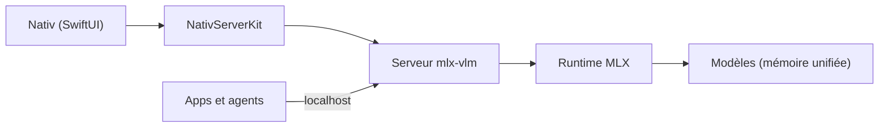

# Blaizzy/nativ

> macOS application for running MLX models locally on Apple silicon, with an API server.

## The problem
Running local models on a Mac means putting together a server, an interface, models and coding tools.

## What it actually does
A SwiftUI app that embeds an `mlx-vlm` server, finds the models in your Hugging Face cache and offers chat, images, a model library, performance analysis and a system monitor. It exposes OpenAI- and Anthropic-compatible routes on `127.0.0.1:8080` and configures coding agents (Codex, Claude Code, Aider…). Audio extension for dictation.

## How it is wired


## Trying it
```bash
brew install --cask nativ
brew install xcodegen
make xcode-generate
make xcode-run
```

## Cost and gotchas
Free. Apple silicon Mac, macOS 26+, enough memory for the model. Model downloads and the first build require network access; microphone and accessibility permissions are requested.

## What it is not
Neither Linux nor Windows, nor a multi-user production server. Inference is local only after the model has been downloaded.

## Alternatives
No alternative named in the README.

## For you
Worth watching if you have an Apple silicon Mac: a good entry point for serving MLX models locally with a familiar API.
