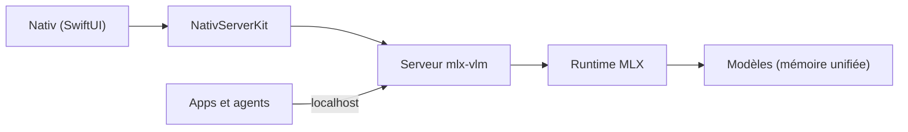

# Blaizzy/nativ

> Application macOS pour faire tourner des modèles MLX en local sur Apple silicon, avec un serveur API.

## Le problème
Exécuter des modèles locaux sur Mac oblige à assembler serveur, interface, modèles et outils de code.

## Ce que ça fait vraiment
App SwiftUI qui embarque un serveur `mlx-vlm`, trouve les modèles de ton cache Hugging Face et propose chat, images, bibliothèque de modèles, analyses de performance et moniteur système. Elle expose des routes compatibles OpenAI et Anthropic sur `127.0.0.1:8080` et configure des agents de code (Codex, Claude Code, Aider…). Extension audio pour la dictée.

## Comment c'est branché


## Essayer
```bash
brew install --cask nativ
brew install xcodegen
make xcode-generate
make xcode-run
```

## Coût et pièges
Gratuit. Mac Apple silicon, macOS 26+, mémoire suffisante pour le modèle. Téléchargements de modèles et premier build exigent le réseau ; les permissions micro et accessibilité sont demandées.

## Ce que ce n'est pas
Ni Linux ni Windows, ni serveur de production multi-utilisateur. L'inférence est locale seulement après téléchargement du modèle.

## Alternatives
Aucune alternative nommée dans le README.

## Pour toi
À surveiller si tu as un Mac Apple silicon : bonne porte d'entrée pour servir des modèles MLX en local avec une API connue.

