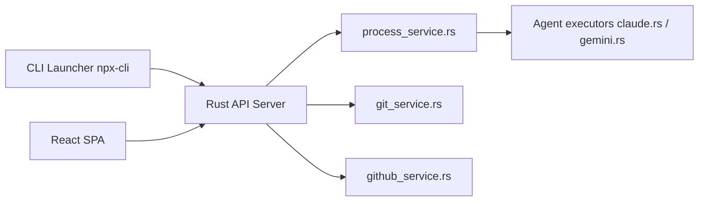

# BloopAI/vibe-kanban

> Kanban board for planning work and launching coding agents in isolated workspaces.

## The problem
Planning and reviewing the work of several coding agents is slower than having them produce it.

## What it actually does
Launched with `npx vibe-kanban`: issues on a board, workspaces with a branch, terminal and development server, diff review with comments sent back to the agent, browser preview, PR creation. More than ten agents supported (Claude Code, Codex, Gemini CLI, Copilot, Amp, Cursor, OpenCode…). Rust backend, React frontend, local SQLite database.

## How it is wired


## Trying it
```bash
npx vibe-kanban
pnpm i
pnpm run dev
```

## Cost and gotchas
You must have authenticated your coding agent beforehand. PostHog variables at build time for analytics (empty = disabled). Behind a reverse proxy, `VK_ALLOWED_ORIGINS` is mandatory, otherwise a 403 error.

## What it is not
The README opens with "Vibe Kanban is sunsetting": the project is end-of-life. Last push on 2026-09-19.

## Alternatives
No alternative named in the README.

## For you
Ignore: the product is announced as being shut down, so there is no point adopting it in a lasting MLOps workflow.
