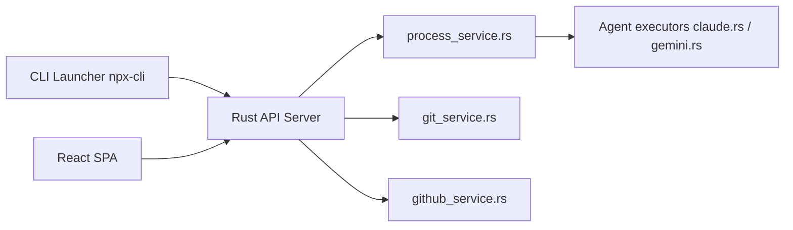

# BloopAI/vibe-kanban

> Tableau kanban pour planifier le travail et lancer des agents de code dans des espaces de travail isolés.

## Le problème
Planifier et relire le travail de plusieurs agents de code est plus lent que de le faire produire.

## Ce que ça fait vraiment
Lancé par `npx vibe-kanban` : issues sur un tableau, espaces de travail avec branche, terminal et serveur de développement, revue de diffs avec commentaires renvoyés à l'agent, aperçu navigateur, création de PR. Plus de dix agents pris en charge (Claude Code, Codex, Gemini CLI, Copilot, Amp, Cursor, OpenCode…). Backend Rust, frontend React, base SQLite en local.

## Comment c'est branché


## Essayer
```bash
npx vibe-kanban
pnpm i
pnpm run dev
```

## Coût et pièges
Il faut avoir authentifié ton agent de code au préalable. Variables PostHog en build pour l'analytique (vides = désactivée). Derrière un reverse proxy, `VK_ALLOWED_ORIGINS` est obligatoire sinon erreur 403.

## Ce que ce n'est pas
Le README ouvre sur « Vibe Kanban is sunsetting » : le projet est en fin de vie. Dernier push le 2026-09-19.

## Alternatives
Aucune alternative nommée dans le README.

## Pour toi
À ignorer : le produit est annoncé comme en arrêt, donc inutile de l'adopter dans un flux MLOps durable.

