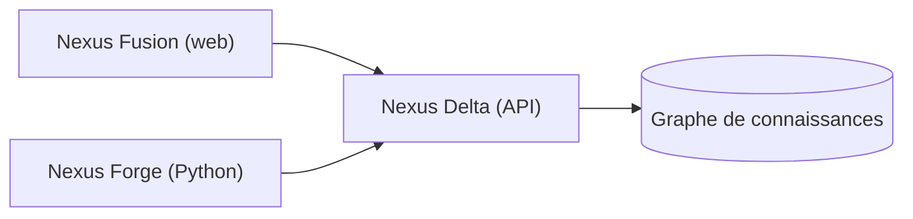

# BlueBrain/nexus

> Knowledge graph ecosystem for organizing research data, coming out of the Blue Brain Project.

## The problem
Scattered scientific data is hard to link, describe and find.

## What it actually does
Three products: Delta (API service that stores and indexes data in a graph), Fusion (web application with Studios and Admin) and Forge (Python framework to build knowledge graphs). The README points to the documentation for all the detail.

## How it is wired
Simplified diagram based on the sheet, no diagram provided.

## Trying it
No command documented in the README: it points to the getting-started guide and the deployment guide on the documentation site.

## Cost and gotchas
You host a full service yourself; the prerequisites are not described in the README. Last push in June 2025: low activity.

## What it is not
It is not a lightweight tool: it is a platform to deploy. The repository is not archived, but its pace has slowed markedly.

## Alternatives
No alternative named in the README.

## For you
Ignore unless you have a specific need for a SHACL knowledge graph: the platform is heavy and its recent activity is low.
