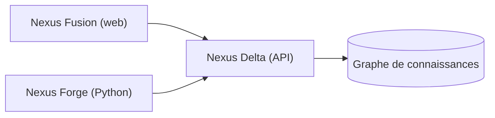

# BlueBrain/nexus

> Écosystème de graphe de connaissances pour organiser des données de recherche, issu du Blue Brain Project.

## Le problème
Des données scientifiques dispersées sont difficiles à relier, à décrire et à retrouver.

## Ce que ça fait vraiment
Trois produits : Delta (service d'API qui stocke et indexe les données dans un graphe), Fusion (application web avec Studios et Admin) et Forge (framework Python pour créer des graphes de connaissances). Le README renvoie à la documentation pour tout le détail.

## Comment c'est branché
Schéma simplifié d'après la fiche, sans diagramme fourni.

## Essayer
Aucune commande documentée dans le README : il renvoie au guide de démarrage et au guide de déploiement du site de documentation.

## Coût et pièges
Hébergement d'un service complet à ta charge ; les prérequis ne sont pas décrits dans le README. Dernier push en juin 2025 : activité faible.

## Ce que ce n'est pas
Ce n'est pas un outil léger : c'est une plateforme à déployer. Le dépôt n'est pas archivé, mais son rythme a nettement ralenti.

## Alternatives
Aucune alternative nommée dans le README.

## Pour toi
À ignorer sauf besoin précis de graphe de connaissances SHACL : la plateforme est lourde et son activité récente est faible.

