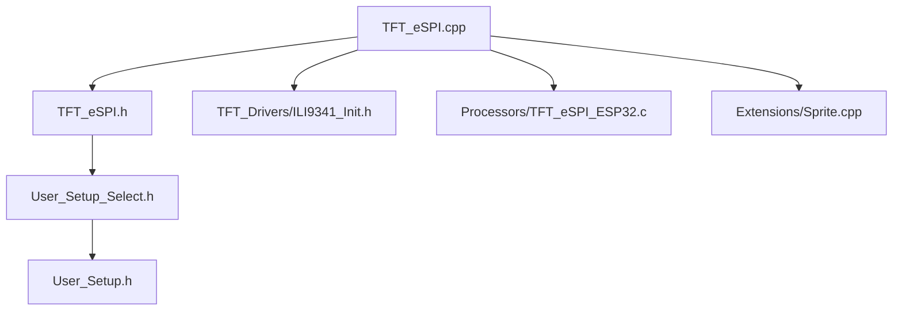

# Bodmer/TFT_eSPI

> Arduino graphics and font library for TFT displays on ESP32, RP2040, STM32 and ESP8266.

## The problem
Driving a TFT display from a microcontroller with decent performance requires code specific to each processor and each controller.

## What it actually does
It provides graphics primitives, proportional and smoothed fonts (vlw format), in-memory "sprites" for flicker-free updates, XPT2046 touch support and DMA depending on the processor. Configuration (pins, controller) is done in `User_Setup.h`, not in the sketch. It supports ILI9341, ST7789, ST7796 and other controllers.

## How it is wired


## Trying it
```bash
# Aucune commande shell : installer par le gestionnaire de bibliothèques de l'IDE Arduino
```

## Cost and gotchas
Free. License not identified by GitHub. The configuration is edited inside the library, so an update can overwrite it (README tip: `TFT_eSPI_Setups` folder). Sprites are limited by RAM.

## What it is not
Not a complete GUI framework. Not every Raspberry Pi-type display is compatible.

## Alternatives
No alternative cited in the README (it is built on Adafruit GFX).

## For you
Ignore unless you have an embedded edge-AI project with a screen: unrelated to a classic data or MLOps pipeline.
