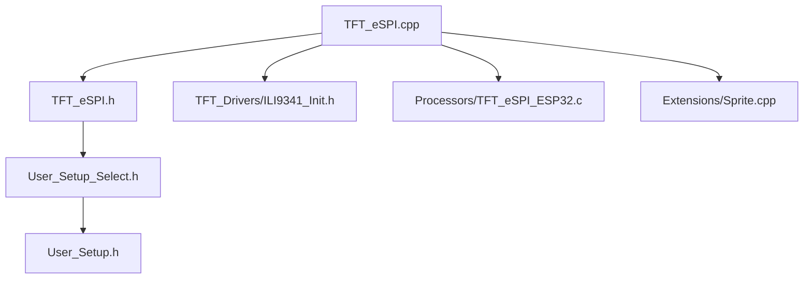

# Bodmer/TFT_eSPI

> Bibliothèque Arduino de graphismes et de polices pour écrans TFT sur ESP32, RP2040, STM32 et ESP8266.

## Le problème
Piloter un écran TFT depuis un microcontrôleur avec des performances correctes demande un code spécifique par processeur et par contrôleur.

## Ce que ça fait vraiment
Elle fournit des primitives graphiques, des polices proportionnelles et lissées (format vlw), des « sprites » en mémoire pour des mises à jour sans scintillement, le tactile XPT2046 et le DMA selon le processeur. La configuration (broches, contrôleur) se fait dans `User_Setup.h`, pas dans le croquis. Elle prend en charge ILI9341, ST7789, ST7796 et d'autres contrôleurs.

## Comment c'est branché


## Essayer
```bash
# Aucune commande shell : installer par le gestionnaire de bibliothèques de l'IDE Arduino
```

## Coût et pièges
Gratuit. Licence non identifiée par GitHub. La configuration se modifie dans la bibliothèque, donc une mise à jour peut l'écraser (astuce du README : dossier `TFT_eSPI_Setups`). Les sprites sont limités par la RAM.

## Ce que ce n'est pas
Pas un framework d'interface graphique complet. Tous les écrans de type Raspberry Pi ne sont pas compatibles.

## Alternatives
Aucune alternative citée dans le README (elle se base sur Adafruit GFX).

## Pour toi
À ignorer sauf projet embarqué d'IA en périphérie avec écran : sans lien avec un pipeline data ou MLOps classique.

